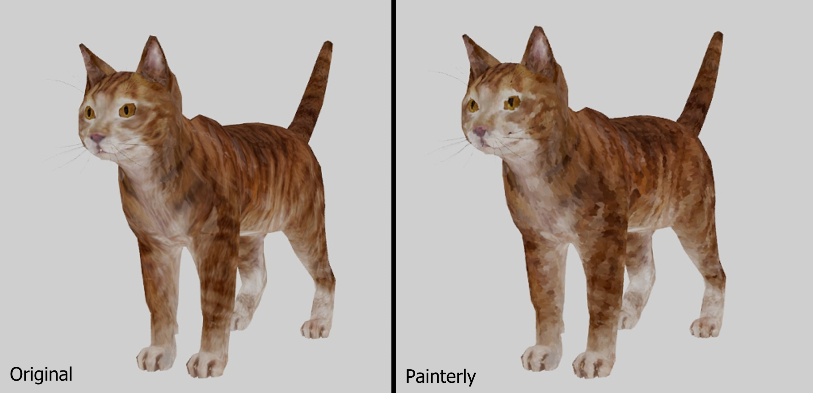

# painterly
A procedural painterly fur and brushstroke generator for Autodesk Maya, developed in Python. Converts textured polygon meshes into stylized, hand-painted surfaces using layered geometry while preserving the original model's texture.

  

# Software Used
Autodesk Maya 2025 • Python • PySide6 • Qt Designer • Adobe Photoshop

# Goals
My goals for this project 
# Planned Features:
•  ✓

•  ✓

# Fur Texture assignment — Painterly Development

  

# Documentation
Documentation includes

• Installation Guide

• How to Use

• Planned Updates

© 2026 Melodi Clark
